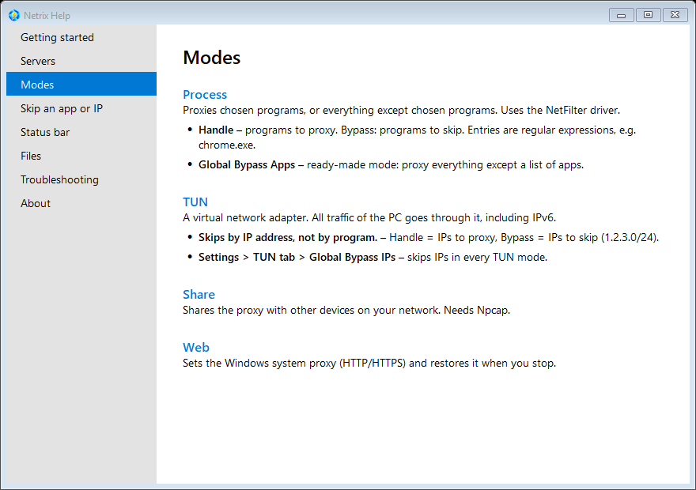

<p align="center">
  
</p>

<h1 align="center">Netrix</h1>

<p align="center">
  <b>A proxy client for Windows.</b><br />
  Send one app, the whole PC, or other devices through a proxy server.
</p>

<p align="center">
  
  
  
  
</p>

<p align="center">
  <a href="#quick-start">Quick start</a> ·
  <a href="#modes">Modes</a> ·
  <a href="#features">Features</a> ·
  <a href="#skip-an-app-or-an-ip">Skip an app or IP</a> ·
  <a href="#troubleshooting">Troubleshooting</a> ·
  <a href="#build">Build</a>
</p>

---

## Quick start

1. **Download** the latest `Netrix.7z` from [Releases](https://github.com/psnwd/netrix/releases) and unpack it anywhere.
2. **Run `Netrix.exe` as administrator.** TUN and Process modes install drivers and change routes.
3. **Add a server:** *Server* menu, or paste a share link and use *Import Servers From Clipboard*, or add a subscription under *Subscription*.
4. **Pick a mode.** If unsure, choose a TUN mode such as **Bypass LAN**.
5. **Press Start.** The number next to each server is its delay in ms; lower is faster.

> New to Netrix? Open **Help > Documentation** inside the app. Hover any control for a tooltip.

<p align="center">
  
</p>

## Modes

| Mode | Proxies | Skips by | Needs |
|---|---|---|---|
| **Process** | Chosen programs, or everything except chosen programs | Program (regular expression on its path) | NetFilter driver |
| **TUN** | The whole PC, IPv4 and IPv6 | IP address or range (CIDR) | WinTUN adapter |
| **Share** | Other devices on your network | -- | [Npcap](https://npcap.com) |
| **Web** | Apps that honour the Windows system proxy | Bypass list | Nothing extra |

**Process**: `handle` rules pick the programs to proxy, `bypass` rules pick the ones to leave alone. Rules are regular expressions, e.g. `chrome.exe`. The *Select* button adds every program in a folder, *Scan* lists the `.exe` files in it.
**TUN**: a virtual adapter takes all traffic, so it also covers apps that ignore proxy settings. If your server has no IPv6, Netrix detects it and rejects IPv6 connections so apps fall back to IPv4 at once instead of hanging.
**Web**: sets the Windows system proxy and puts your old values back when you stop, even after a crash.

## Features

### Servers
- Shadowsocks, ShadowsocksR, SOCKS5, SSH, Trojan, VMess, VLESS, WireGuard
- Add by hand, from share links on the clipboard, or from a subscription (refreshed when Netrix opens)
- Delay test with TCP or ICMP ping, repeated while the window is open

### Everything else
- **NAT type test** in the status bar (1 open, 2 restricted, 3 symmetric) using a STUN server you choose
- **Speed and usage** in the status bar: download and upload shown separately in TUN mode
- **Quick-start profiles**: save a server and a mode under a name, then start with one click. Click to use, Ctrl+Click to save, Shift+Click to delete
- **Local DNS** (AioDNS) with a response cache, or your own DNS server
- **UDP** relayed through the proxy, with FullCone NAT when the server supports it
- **Safe updates**: the app only installs a release signed with the project key, checks the file hash, and rolls back if applying the update fails
- **Built-in help, tooltips and keyboard shortcuts** (Enter saves Settings, Esc closes small windows)

## Skip an app or an IP

<table>
<tr>
<td width="50%" valign="top">

**Skip a program**

Use a Process mode and add the exe name to its *Bypass* list. The ready-made mode **Global Bypass Apps** proxies everything except a list of apps.

TUN mode cannot skip by program, because Windows routes by address only.

</td>
<td width="50%" valign="top">

**Skip an IP or range**

Use a TUN mode and add the address to its *Bypass* list, e.g. `192.168.0.0/16`. To skip it in every TUN mode, use *Settings > TUN tab > Global Bypass IPs*.

</td>
</tr>
</table>

## Troubleshooting

| Symptom | Try |
|---|---|
| Nothing connects | Check the server delay, then read `logging\application.log` |
| TUN mode will not start | Run as administrator; check that `bin\wintun.dll` exists |
| NAT shows **NoUDP** | Pick another STUN server in Settings; if all fail, the proxy server blocks UDP |
| NAT shows **UnsupportedServer** | That STUN server cannot do the test. Use `stun.1und1.de` (the default), `stun.miwifi.com` or `stun.fitauto.ru` |
| One site hangs, others work | Probably IPv6. Look for "no working IPv6 path" in the log |
| Internet gone after a crash | Start Netrix again; it restores the system proxy. Also try *Options > Remove Netrix Firewall Rules* |
| An update broke something | A failed update rolls back to the old files automatically |

## Files

Next to `Netrix.exe`:

| Folder | Contents |
|---|---|
| `data\` | Settings and server list. Back this up |
| `mode\` | Mode files, editable as text or JSON |
| `logging\` | Logs, including `tun2socks.log` |
| `bin\` | Helper programs and drivers |

## Build

Needs the .NET 10 SDK, MSBuild with the C++ toolchain, and Go and Rust for the bundled helper programs.

```powershell
.\build.ps1                         # full build into .\.build (keeps .build\data)
.\build.ps1 -PlatformToolset v145   # machine with only Visual Studio 2026
dotnet test Tests\Tests.csproj -p:Platform=x64
```

| Path | What it is |
|---|---|
| `Netrix/` | The WinForms app |
| `Redirector/`, `RouteHelper/` | Native C++ helpers (process redirector, route table) |
| `Other/` | Helpers built from source: tun2socks, aiodns, pcap2socks, v2ray-sn, wintun |
| `Storage/` | Files shipped with a release: translations, mode files, STUN list, driver |
| `Tests/` | Unit tests |
| `.docs/` | Notes, task list, performance results |

Toolchain details are in [.docs/CLAUDE.md](.docs/CLAUDE.md). Release signing is described in [sign.ps1](sign.ps1).

## Problems and ideas

Open an [issue](https://github.com/psnwd/netrix/issues) and attach the log from the `logging` folder.

## Credits

Netrix is based on [Netch](https://github.com/NetchX/Netch), Copyright (c) 2019 AmazingDM and Contributors. Third-party components are listed in [Netrix/NOTICE.txt](Netrix/NOTICE.txt).

## License

[GPLv3](LICENSE)
