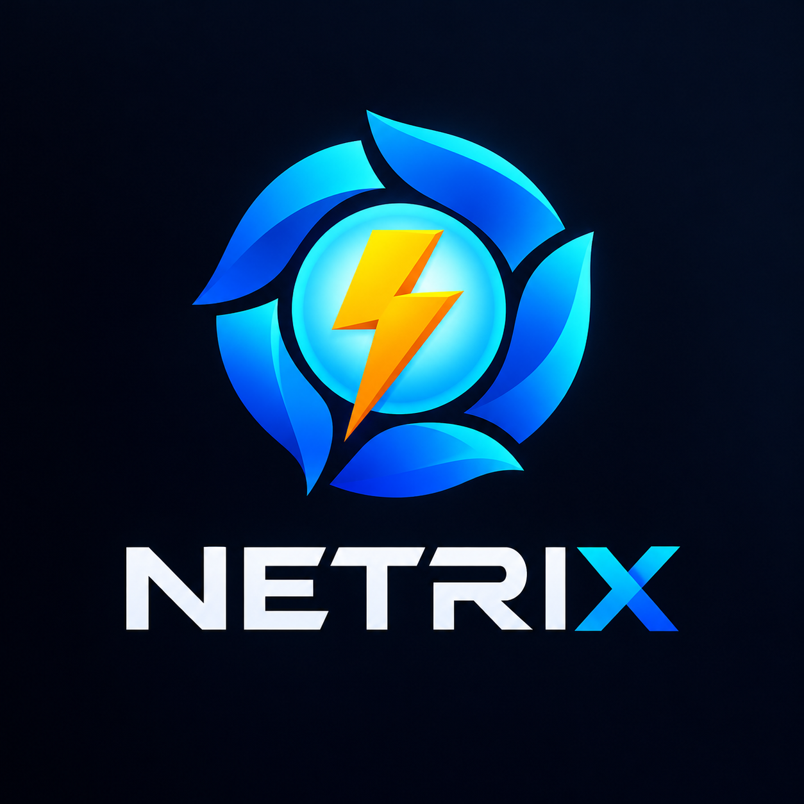

<p align="center"></p>

<div align="center">

# Netrix
A proxy client for Windows: send one app, the whole PC, or other devices through a proxy server.

</div>

## Features

### Modes
| Mode | What it does |
|---|---|
| **Process** | Proxy chosen programs, or everything except chosen programs (NetFilter driver) |
| **TUN** | Virtual network adapter (WinTUN): the whole PC goes through it, IPv4 and IPv6. Skip IPs and ranges |
| **Share** | Share the proxy with other devices on your network (Npcap) |
| **Web** | Set the Windows system proxy; only apps that honour it are proxied. Restored when you stop |

### Protocols
Shadowsocks, ShadowsocksR, SOCKS5, SSH, Trojan, VMess, VLESS, WireGuard.
Add servers by hand, from share links on the clipboard, or from a subscription.

### Also
- NAT type test and server delay test in the main window
- Download and upload speed in TUN mode
- Quick-start profiles: save a server and a mode, start with one click
- Built-in help and tooltips (Help > Documentation)
- Signed updates: the app only installs a release signed with the project key
- UDP FullCone NAT (limited by your server)

## Requirements
- Windows 10 or 11, x64
- Run as administrator: TUN and Process modes install drivers and change routes
- [Npcap](https://npcap.com) for Share mode

## Download
Get the latest `Netrix.7z` from [Releases](https://github.com/psnwd/netrix/releases), unpack it, and run `Netrix.exe` as administrator.

## Build
Needs the .NET 10 SDK, MSBuild with the C++ toolchain, and Go and Rust for the bundled helper programs.

```powershell
.\build.ps1                         # full build into .\.build (keeps .build\data)
.\build.ps1 -PlatformToolset v145   # machine with only Visual Studio 2026
dotnet test Tests\Tests.csproj -p:Platform=x64
```

Toolchain details are in [.docs/CLAUDE.md](.docs/CLAUDE.md). Release signing is described in [sign.ps1](sign.ps1).

## Problems
Open an [issue](https://github.com/psnwd/netrix/issues) and attach the log from the `logging` folder next to `Netrix.exe`.

## Credits
Netrix is based on [Netch](https://github.com/NetchX/Netch), Copyright (c) 2019 AmazingDM and Contributors. Third-party components are listed in [Netrix/NOTICE.txt](Netrix/NOTICE.txt).

## License
[GPLv3](LICENSE)
